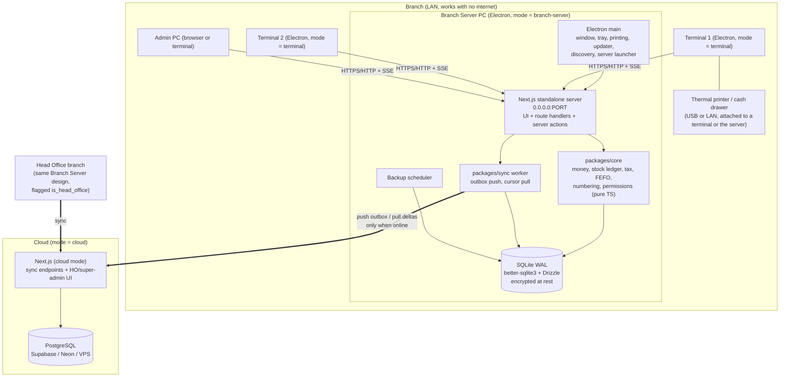
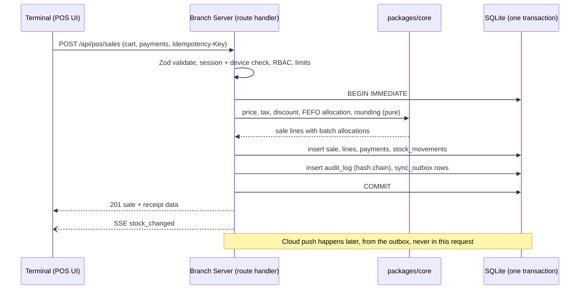

# Architecture (Phase 0)

Status: **Draft for approval.** Nothing here is implemented yet. Stack is the fixed stack from CLAUDE.md §3; the open decisions are listed as ADR proposals in [../adr/README.md](../adr/README.md).

> Product name: **Mediescare** (owner confirmed; it matches the logo wordmark). It is a single config constant (`APP_NAME` in `packages/config`).

## 1. Goals that shape the design

1. POS and inventory never wait on the network.
2. Several terminals write to one branch database at the same time, safely.
3. Many branches, one Head Office (HO), one cloud database for consolidated views.
4. Stock and money are append-only. Mistakes are fixed by new documents, not edits.
5. One language (TypeScript), one framework (Next.js), one desktop shell (Electron).

## 2. Component view



## 3. The four runtime modes

All four run the same codebase. `MEDIESCARE_MODE` selects behaviour. `packages/db` exposes one repository interface with a SQLite driver and a Postgres driver.

| Mode | Runs | Owns data | Network needs | Typical use |
|---|---|---|---|---|
| `single` | Electron + embedded Next.js on `127.0.0.1` + SQLite + sync worker | Yes (SQLite) | None (cloud optional) | One-PC branch |
| `branch-server` | Same as `single` but bound to `0.0.0.0`, LAN-discoverable, firewall rule | Yes (SQLite) | LAN for terminals, internet for sync only | Multi-counter branch, and Head Office |
| `terminal` | Electron window only. Loads UI from the branch server. Local printing/scanner bridge | **No** (holds only a session, a small UI cache and print queue) | LAN to branch server | Extra counters |
| `cloud` | Next.js on a server + Postgres | Yes (Postgres) | Internet | HO consolidated analytics, sync endpoints, super-admin |

Head Office is **a branch with a flag** (`branches.is_head_office = true`, main store). It runs `branch-server` or `single` like any other branch. This keeps one code path for the HO to branch stock flow.

### First-run wizard

1. Choose: Single PC / Branch Server / Branch Terminal (Head Office = Branch Server with the HO flag chosen at branch binding).
2. Activation (licence key, offline-verifiable signed token; online check is optional).
3. Branch binding (pick or create a branch, or pair to a cloud tenant by pairing code).
4. Server only: pick port, create the firewall rule (Windows: `netsh advfirewall`, needs elevation, explain and show the manual command as a fallback), create the first Super Admin, set the DB encryption key (see ADR-0001).
5. Terminal only: discover servers (mDNS + UDP broadcast) or enter IP:port, pair with a one-time code shown on the server, register the device.

## 4. LAN branch-server model

- **Single writer.** Only the branch server process opens the SQLite file. Terminals never touch it. SQLite WAL plus one process avoids file-locking problems on network shares (never put the DB on a shared folder).
- **Short transactions.** Every write action is one transaction: validate, authorize, apply core logic, write audit row, append outbox row, commit. `busy_timeout` is set as a safety net. Writes are serialized in-process through one connection (better-sqlite3 is synchronous, so a sale is a few milliseconds).
- **Optimistic locking** (`version` column) on editable master data. Ledger and documents are insert-only.
- **Server-side stock deduction.** A sale is one server transaction that allocates FEFO batches and inserts `stock_movements`. Insufficient stock rejects the sale unless negative stock is enabled for that item or branch.
- **Server-side carts.** Hold invoices and open carts live in the DB so any terminal can resume them.
- **Live updates.** Server-Sent Events channel per branch: stock changes, hold-invoice changes, price changes, sync status. Terminals fall back to short polling if SSE drops.
- **Discovery.** mDNS service `_mediescare._tcp` plus a UDP broadcast fallback (some routers block mDNS). Manual IP always works. The server advertises `branch_id`, name, version, and protocol version. Terminals refuse a server with an incompatible protocol version.
- **Transport security.** TLS with a per-server self-signed certificate created at setup. The terminal pins the certificate fingerprint at pairing time. Plain HTTP is allowed only on `127.0.0.1` (`single` mode).
- **Device pairing.** Each terminal has a device record and a device token. A revoked device is refused at the server. User login is separate (password or PIN, see ADR-0003).
- **Printing.** Receipts print at the terminal that made the sale through Electron main (ESC/POS over USB/serial/LAN). Reports and A4 PDFs use the OS print pipeline. The server can also hold shared network printers.
- **Time.** The server clock is the branch time authority. Terminals show server time. HLC (see [sync-design.md](sync-design.md)) tolerates the server clock itself being wrong versus other branches.

## 5. Data flow of one POS sale



`Idempotency-Key` makes a retried request after a LAN blip return the original sale instead of creating a second one.

## 6. Failover: the branch server PC goes down

Design principle: **a branch must be able to keep selling within minutes, with no data loss for anything already committed.** Three tiers, in the order of how much they cost to run. Which tiers to build is an approval item (ADR-0004, [open-questions.md](open-questions.md) Q2).

### Tier 0 (always on, Phase 1-2): fast recovery from backup

- Encrypted scheduled backups on the server (rolling) plus an automatic **backup copy pushed to a designated standby terminal** over LAN every N minutes (default 15), plus cloud backup when online.
- Loss window equals the backup interval. Good enough only if the owner accepts it. Sales made in that window can be recovered from the terminals' **local write-ahead journal** (below).
- **Terminal local journal:** each terminal keeps an encrypted local queue of the last committed receipts (receipt id, payload hash). It is used only for reconciliation after a restore. It does not let the terminal sell on its own.

### Tier 1 (recommended, Phase 3): warm standby terminal

- One terminal is designated **standby**. The primary streams its change log to it: every committed transaction batch, using the same rows as `sync_outbox` plus the ledger tables, applied on the standby into a second SQLite file (near-real-time replication, seconds of lag).
- Failover is **manual and one click** ("Promote this PC to Branch Server"), deliberately not automatic, to avoid two servers accepting writes (split brain).
- Promotion steps: verify the old primary is unreachable, apply the last received log, bump a **server epoch** number stored in the DB, start the server on the same port, advertise via mDNS. Terminals reconnect automatically because discovery is by branch id, not IP. Fixed-IP or DNS alias is also supported.
- **Epoch fencing:** every write and every sync push carries the epoch. If the old server comes back with a lower epoch, it detects a higher epoch on the cloud or on the LAN, refuses writes, and offers "re-join as standby" which wipes and re-seeds it from the new primary. Unreplicated tail transactions on the old primary are exported to a **recovery file** and reviewed by a manager, then re-posted as normal documents (nothing is silently dropped).
- Document numbers: counters are reserved in blocks (for example 1,000 numbers at a time), and the promoted standby continues after the last replicated number plus a safety gap. Numbers keep the plain `KHI01-INV-000123` format. Gaps are possible after a failover and are explained in the audit log. This prevents duplicate invoice numbers after promotion.

### Tier 2 (optional, later): automatic failover

- A witness (any third machine or the cloud) plus lease-based leadership. Only worth building if manual promotion proves too slow. It adds real complexity, so it is not planned before Phase 6.

### Degraded mode when no server is reachable and no promotion is done yet

- Terminals show a clear "Branch server offline" state and block sales. **Optional emergency mode** (off by default, needs owner approval, see Q2): a terminal may issue **provisional receipts** from a small cached price and stock snapshot, marked `PROVISIONAL`, numbered from a reserved terminal-local block, and reconciled into normal invoices when the server returns. This is the only case where a terminal writes its own data, and it is constrained to sale-only, cash-only, no controlled drugs.

### What is guaranteed after failover

| Item | Tier 0 | Tier 1 |
|---|---|---|
| Committed sales, purchases, transfers | Lost only if newer than last backup and not in a terminal journal | Lost only if newer than last replicated batch (seconds) |
| Doc numbers unique | Yes (block reservation) | Yes (epoch + gap) |
| Stock ledger consistent | Yes (movements are replayed idempotently by id) | Yes |
| Sync to cloud | Resumes, idempotent by outbox id | Resumes |

## 7. Cloud mode

- Same Next.js app, Postgres via Drizzle, provider swappable behind a `CloudAdapter` (Supabase, Neon, VPS).
- Endpoints: `POST /sync/push`, `GET /sync/pull`, `POST /sync/register-device`, health. Auth by device token plus branch scope. Multi-tenant from day one (`tenant_id` on every synced table, row-level checks in the adapter, optional Postgres RLS).
- HO/super-admin UI reads Postgres for consolidated analytics. Branches show a "data as of" timestamp so stale data is obvious.
- Cloud never blocks a branch: no branch operation calls the cloud synchronously.

## 8. Repository and layering (as in CLAUDE.md §4.2)

```
apps/web        Next.js UI, route handlers, server actions (thin)
apps/desktop    Electron main/preload, updater, printing, discovery, server launcher
packages/core   pure domain logic (no I/O)
packages/db     Drizzle schemas (sqlite + pg), migrations, seeds, parity tests
packages/sync   outbox, push/pull, HLC, conflict rules, cloud adapter
packages/config tsconfig, eslint, tailwind tokens
```

Request path: **Zod parse, authorize (RBAC + branch scope), one DB transaction (core logic, rows, audit, outbox), respond.** No business rules in components or handlers.

## 9. Cross-cutting decisions

| Concern | Decision | Where decided |
|---|---|---|
| SQLite encryption | Needs a choice: SQLCipher build vs OS-level (BitLocker/EFS) | ADR-0001 |
| Money scale | Integer paisa for amounts; higher fixed scale for per-unit cost | ADR-0002 |
| Auth | argon2, jose cookies, PIN for POS, optional TOTP | ADR-0003 |
| Branch-server failover | Tiers above | ADR-0004 |
| Search | SQLite FTS5 (name, generic, salt, barcode), trigram/prefix index | ADR-0005 |
| IDs and HLC | UUIDv7 keys, HLC per device | ADR-0006 |
| Electron and Next.js packaging | Standalone output run by Electron's bundled Node (`utilityProcess`), native modules rebuilt | ADR-0007 |
| Audit tamper evidence | SHA-256 hash chain per branch, anchored in cloud | ADR-0008 |
| Document numbering | `BRANCH-TYPE-SEQ` from per-branch counters, reserved blocks | ADR-0009 |

## 10. Risks called out early

1. **Native modules in the packaged Electron build** (better-sqlite3, SQLCipher, printer libs). Mitigation: packaged-installer smoke test in Phase 1 CI, not deferred.
2. **Next.js standalone inside Electron.** Bundle size and cold start (budget: under 5 s on 4 GB RAM). Mitigation: measure in Phase 1; server runs in a separate process from the window.
3. **SQLCipher with better-sqlite3** needs a special build (`better-sqlite3-multiple-ciphers` or a custom build). Verify Windows prebuilds before committing (ADR-0001).
4. **Urdu on thermal printers.** Most ESC/POS printers do not have Urdu fonts, so Urdu receipts are rendered as bitmap. Needs the printer model to size it (Q6).
5. **Clock skew on cheap PCs.** Covered by HLC, but document dates shown to users still come from the server.
