# Data model (Phase 1-3)

Status: **Draft for approval.** Logical model. Column-level detail is finalised per phase in Drizzle schemas (SQLite and Postgres, parity test enforced).

## 1. Conventions (apply to every table unless stated)

| Rule | Detail |
|---|---|
| Primary key | `id` UUIDv7 (text in SQLite, `uuid` in Postgres). No auto-increment. |
| Naming | `snake_case` columns, plural table names. |
| Tenancy | `tenant_id` on every synced table (constant in single-tenant installs, needed for the cloud). |
| Branch | `branch_id` on every branch-owned row (documents, movements, shifts, expenses). Master data is tenant-wide, with optional per-branch overrides. |
| Sync columns | `hlc` (hybrid logical clock, text), `origin_device_id`, `created_at`, `updated_at` (UTC). Editable master data adds `version` (int, optimistic lock) and `deleted_at` (soft delete). |
| Money | Integer minor units (paisa) in `*_minor` columns. Per-unit cost and rate use the high-precision scale from ADR-0002 (`*_unit_micro`, proposal: 1e-4 paisa). No floats. |
| Quantity | Integer in the **smallest stocking unit** (for example tablets), plus a `unit_id` and `conversion` on the line for display. |
| Immutability | Posted documents and `stock_movements` are insert-only. Enforced by DB triggers in SQLite/Postgres and by the repository layer. Corrections are new documents that reference `reverses_id`. |
| Document numbers | Human number `doc_no` = `BRANCH-TYPE-SEQ`, unique per `(tenant_id, doc_no)`. Separate from `id`. |

## 2. Entity-relationship overview

```mermaid
erDiagram
  TENANTS ||--o{ BRANCHES : has
  BRANCHES ||--o{ STORES : has
  BRANCHES ||--o{ DEVICES : registers
  BRANCHES ||--o{ USER_BRANCHES : grants
  USERS ||--o{ USER_BRANCHES : has
  USERS ||--o{ USER_ROLES : has
  ROLES ||--o{ USER_ROLES : assigned
  ROLES ||--o{ ROLE_PERMISSIONS : grants
  PERMISSIONS ||--o{ ROLE_PERMISSIONS : in

  ITEMS ||--o{ ITEM_BARCODES : has
  ITEMS ||--o{ ITEM_UNITS : sold_as
  ITEMS ||--o{ BATCHES : stocked_as
  ITEMS }o--|| CATEGORIES : in
  ITEMS }o--o| MANUFACTURERS : made_by
  ITEMS }o--o| RACKS : shelved
  ITEMS ||--o{ ITEM_SUPPLIERS : supplied_by
  SUPPLIERS ||--o{ ITEM_SUPPLIERS : supplies

  BATCHES ||--o{ STOCK_MOVEMENTS : moves
  STORES ||--o{ STOCK_MOVEMENTS : in_store
  STOCK_MOVEMENTS }o--|| STOCK_DOCS : "source doc (polymorphic)"

  SALES ||--|{ SALE_LINES : has
  SALE_LINES ||--o{ SALE_LINE_ALLOCATIONS : "FEFO batch split"
  SALE_LINE_ALLOCATIONS }o--|| BATCHES : takes_from
  SALES ||--o{ SALE_PAYMENTS : paid_by
  SALES ||--o{ SALE_RETURNS : returned_by
  SALES }o--o| CUSTOMERS : for
  SALES }o--|| SHIFTS : during
  SALES }o--o| DOCTORS : "referred by"

  PURCHASE_ORDERS ||--|{ PO_LINES : has
  PURCHASE_ORDERS ||--o{ GRNS : received_by
  GRNS ||--|{ GRN_LINES : has
  GRN_LINES }o--|| BATCHES : creates
  GRNS ||--o{ SUPPLIER_PAYMENTS : settled_by
  SUPPLIERS ||--o{ GRNS : sends

  REQUISITIONS ||--|{ REQUISITION_LINES : has
  REQUISITIONS ||--o{ TRANSFERS : fulfilled_by
  TRANSFERS ||--|{ TRANSFER_LINES : has
  TRANSFER_LINES }o--|| BATCHES : picks
  TRANSFERS ||--o{ TRANSFER_RECEIPTS : received_by
  TRANSFER_RECEIPTS ||--|{ TRANSFER_RECEIPT_LINES : has

  SHIFT_DEFINITIONS ||--o{ SHIFTS : instantiates
  SHIFTS ||--o{ CASH_MOVEMENTS : records
  SHIFTS ||--o{ SHIFT_COUNTS : blind_count

  EXPENSE_CATEGORIES ||--o{ EXPENSES : classifies
  EXPENSES }o--o| SHIFTS : "paid during"

  USERS ||--o{ AUDIT_LOG : acts
  BRANCHES ||--o{ SYNC_OUTBOX : queues
  BRANCHES ||--o{ SYNC_CURSORS : tracks
```

## 3. Table list

Legend: **P1/P2/P3** = first phase needing the table. `S` = synced to cloud, `L` = local only.

### 3.1 Identity, access, tenancy (P1)

| Table | Purpose | Key columns | Sync |
|---|---|---|---|
| tenants | Organisation (cloud isolation) | id, name, licence_ref | S |
| branches | Branch and Head Office | id, code (`KHI01`), name, is_head_office, address, licence_no, ntn, timezone, doc_prefix, status | S |
| stores | Physical stock locations inside a branch: main, counter, cold room, quarantine, damaged, expired, in-transit | id, branch_id, kind, name | S |
| devices | Registered terminals/servers | id, branch_id, name, role (server/terminal), token_hash, cert_fingerprint, last_seen_at, revoked_at | S |
| users | Staff logins | id, username, email, phone, password_hash (argon2id), pin_hash, totp_secret_enc, language, status, must_change_pw, last_login_at, priority_modules (json) | S |
| roles | Built-in and custom roles | id, code, name, is_system, discount_limit_bp, refund_limit_minor, price_override_limit_bp | S |
| permissions | Catalogue of `module.resource.action` keys | key (pk), module, description | S (seeded) |
| role_permissions | Role grants | role_id, permission_key, field_rules (json) | S |
| user_roles | User to role | user_id, role_id | S |
| user_branches | Branch scope, `all_branches` flag for Super Admin | user_id, branch_id or null, all_branches | S |
| sessions | Server sessions, revocable | id, user_id, device_id, expires_at, revoked_at | L |
| override_events | Manager-PIN overrides | id, branch_id, requested_by, approved_by, kind, reference, reason, at | S |
| settings | Key/value config with scope (tenant, branch) | scope, scope_id, key, value_json, version | S |
| feature_flags | Module toggles per branch | branch_id, module, enabled | S |

### 3.2 Catalogue (P2)

| Table | Purpose | Key columns |
|---|---|---|
| items | Item master (pharma and general retail) | id, sku, name, generic_name, brand, strength, dosage_form, category_id, manufacturer_id, rack_id, stocking_unit_id, tax_class_id, is_prescription, is_narcotic, is_cold_chain, is_dead_flag, is_active, reorder_level, min_qty, max_qty, drap_reg_no, item_type, b2b_category_id, tags (via item_tags), version |
| item_barcodes | Many barcodes per item | item_id, barcode (unique per tenant), unit_id |
| item_units | Selling units and conversion to smallest unit | item_id, unit_id, factor_to_base, is_default_sale, is_default_purchase |
| units | Unit master (tablet, strip, pack, bottle, piece) | id, code, name |
| item_prices | Price list with effective dates | item_id, price_list_id, unit_id, rate_unit_micro, effective_from, set_by_ho |
| price_lists | Retail, wholesale, customer-group tiers | id, name, kind |
| categories, sub_categories | Category tree | id, parent_id, name |
| manufacturers | | id, name |
| racks | | id, branch_id, code |
| tags, item_tags | | id, name, colour |
| item_salts, salts | Composition for substitution search | item_id, salt_id, strength |
| suppliers | Supplier master | id, name, phone, ntn, strn, terms_days, credit_limit_minor, opening_balance_minor |
| item_suppliers | Which suppliers supply an item | item_id, supplier_id, last_cost_unit_micro |
| tax_classes, tax_rates | Configurable tax (Sales Tax, Advance Tax, WHT) | id, name, kind, rate_bp, applies_to |
| items_fts | SQLite FTS5 virtual table (name, generic, salts, barcodes) | rebuilt from items, local index, not synced |

### 3.3 Batches and stock ledger (P2)

| Table | Purpose | Key columns |
|---|---|---|
| batches | One row per item, batch number, expiry, cost | id, item_id, batch_no, mfg_date, expiry_date, cost_unit_micro, mrp_unit_micro, sale_rate_unit_micro, origin_doc_type, origin_doc_id, supplier_id, is_recalled, is_quarantined |
| stock_movements | **Append-only ledger.** Stock = sum of `qty_base` | id, branch_id, store_id, item_id, batch_id, kind, qty_base (signed integer), unit_cost_micro, doc_type, doc_id, doc_line_id, reverses_id, occurred_at, hlc, user_id |
| stock_balances | **Derived cache** (branch, store, batch) recomputed from movements, never edited by hand | branch_id, store_id, batch_id, qty_base, as_of_movement_id, local only, rebuildable |
| stock_adjustments, stock_adjustment_lines | Adjustment, consume, expiry write-off, count variance documents | id, branch_id, kind, reason_code, approved_by, status |
| stock_counts, stock_count_lines | Physical count and cycle count | id, branch_id, store_id, status, counted_by |
| missed_sales | Demanded but unavailable | id, branch_id, item_id or free_text, unit_id, qty, customer_phone, preferred_supplier_id, user_id, resolved_by_po_id |

`kind` values: `opening, purchase, sale, sale_return, purchase_return, transfer_out, transfer_in, adjustment, expiry_writeoff, consume, in_transit_out, in_transit_in`.

### 3.4 Sales and POS (P2)

| Table | Purpose | Key columns |
|---|---|---|
| customers | Customer/patient (walk-in default record) | id, mr_no, name, phone, cnic, gender, is_walkin, credit_limit_minor, group_id, hw_external_id |
| doctors | Referring doctors (narcotic register, doctor-wise sales, share) | id, name, licence_no, share_bp |
| sales | Invoice header, immutable when posted | id, branch_id, doc_no, customer_id, doctor_id, shift_id, status (`posted`, `void`), source (`pos`), sub_total_minor, discount_minor, tax_minor, rounding_minor, grand_total_minor, paid_minor, due_minor, advance_used_minor, note, created_by, terminal_id, idempotency_key, voided_by, void_reason, voided_at |
| sale_lines | | id, sale_id, item_id, unit_id, qty_base, rate_unit_micro, discount_minor, tax_minor, net_minor, cost_total_minor (from batches), missed_sale_id |
| sale_line_allocations | FEFO split of a line over batches | sale_line_id, batch_id, qty_base, cost_unit_micro |
| sale_payments | Split tender | id, sale_id, mode_id, amount_minor, reference, paid_at |
| payment_modes | Cash, card, Easypaisa/JazzCash, bank, QR, credit | id, code, kind, opens_drawer |
| sale_returns, sale_return_lines | Return against invoice line/batch, refund, restock or damage | id, sale_id, doc_no, reason_code, refund_minor, refunded_by, restock_to (`store`/`damaged`) |
| credit_notes | Issued for returns | id, sale_return_id, customer_id, amount_minor |
| hold_invoices | Server-side carts (mutable until posted or deleted) | id, branch_id, created_by, payload_json, version, updated_at |
| narcotic_register | One row per controlled-item sale line | sale_line_id, patient_name, cnic, doctor_id, prescription_ref |
| customer_ledger | Receivable entries | customer_id, doc_type, doc_id, debit_minor, credit_minor |
| receipts_customer | Payments against dues | id, customer_id, amount_minor, mode_id, shift_id |
| print_jobs | Reprint tracking, duplicate copy marker | id, doc_type, doc_id, copy_no, printed_by |

### 3.5 Purchasing (P2)

| Table | Purpose | Key columns |
|---|---|---|
| purchase_orders, po_lines | PO with approval | id, branch_id, supplier_id, doc_no, status, approved_by |
| grns, grn_lines | Goods receipt / "Add New Stock" | id, branch_id, doc_no, supplier_id, supplier_invoice_no, supplier_invoice_date, discount_minor, sales_tax_minor, advance_tax_minor, wht_minor, freight_minor, total_minor, stock_note, status; lines: item_id, batch_no, expiry_date, qty_base, loose_qty, bonus_qty, cost_unit_micro, tax_minor |
| purchase_returns, purchase_return_lines | Return to supplier, supplier credit note | |
| supplier_ledger | Payables | supplier_id, doc_type, doc_id, debit_minor, credit_minor |
| supplier_payments | Bill payments and opening-balance payments | id, supplier_id, grn_id or null, amount_minor, mode_id, shift_id |
| attachments | Files for GRN/expense (path, sha256, size) | id, owner_type, owner_id, path |

### 3.6 Head Office to branch transfers (P3)

| Table | Purpose | Key columns |
|---|---|---|
| requisitions, requisition_lines | Branch indent (or HO push) | id, from_branch_id, to_branch_id (HO), doc_no, status, needed_by |
| transfers, transfer_lines | Transfer note / delivery challan, batch-wise | id, doc_no, from_branch_id, to_branch_id, requisition_id, status, price_basis (`cost`/`transfer_price`), dispatched_by, dispatched_at; lines: item_id, batch_id, qty_base, unit_cost_micro |
| transfer_receipts, transfer_receipt_lines | Receiving side, partial, shortage, damage | transfer_id, line_id, received_qty, short_qty, damaged_qty, rejected_qty, reason |
| inter_branch_balances | Inter-branch accounting balance per pair | from_branch_id, to_branch_id, amount_minor (derived) |

### 3.7 Shifts, cash and expenses (P2 shifts and expenses basics, P4 full)

| Table | Purpose | Key columns |
|---|---|---|
| shift_definitions | Configurable shifts (name, start, end, days) | id, branch_id, name, starts_at, ends_at |
| shifts | A cashier shift instance | id, branch_id, definition_id, opened_by, opened_at, closed_by, closed_at, float_minor, status |
| shift_counts | Blind count and denominations | shift_id, denomination, count, counted_by |
| cash_movements | Cash in/out inside a shift (sales cash, expenses, handover, petty cash) | id, shift_id, kind, amount_minor, doc_type, doc_id |
| shift_reports | Stored X/Z snapshots (immutable) | id, shift_id, kind, totals_json |
| expense_categories | Custom and locked system categories | id, name, is_system, locked |
| expenses | Expense vouchers, immutable when posted | id, branch_id, doc_no, category_id, employee_id, amount_minor, mode_id, occurred_at, description, invoice_no, shift_id, status, approved_by |
| petty_cash_accounts | (P4) | id, branch_id, custodian_id |

### 3.8 Audit and sync (P1)

| Table | Purpose | Key columns |
|---|---|---|
| audit_log | Append-only, hash-chained | id, branch_id, seq, user_id, device_id, action, entity_type, entity_id, old_json, new_json, at, prev_hash, hash |
| sync_outbox | Durable change queue | id, seq (local monotonic), entity_type, entity_id, op, payload_json, hlc, device_id, branch_id, attempts, next_attempt_at, sent_at, ack_at, error |
| sync_cursors | Per entity type pull position | entity_type, remote_cursor, last_pulled_at |
| sync_inbox_seen | Idempotency for incoming events (dedupe) | event_id, applied_at |
| sync_conflicts | Rows needing manager review | id, entity_type, entity_id, local_json, remote_json, rule, status |
| doc_counters | Per branch and doc type sequence, block reservation | branch_id, doc_type, next_no, block_start, block_end, epoch |
| backups | Backup history | id, path, size, sha256, kind, created_at, verified_at |
| schema_migrations | Drizzle | |

## 4. Key invariants (each has a test)

1. `stock_balances.qty_base` equals `SUM(stock_movements.qty_base)` for the same key, always. The cache can be dropped and rebuilt.
2. A `sale_line` quantity equals the sum of its `sale_line_allocations`.
3. A `sale_line_allocation` never takes from an expired, recalled or quarantined batch.
4. `grand_total_minor = sub_total - discount + tax + rounding` and `paid + due = grand_total` (after advance).
5. Any update or delete on posted documents and on `stock_movements` fails (trigger).
6. `audit_log.hash = H(prev_hash || canonical(row))`, and the chain verifies end to end.
7. Every write to a synced table has exactly one matching `sync_outbox` row in the same transaction.
8. SQLite and Postgres schemas contain the same tables and columns (parity test).

## 5. Indexes that matter for the performance budget

- `items_fts` (FTS5, prefix index) for the sub-100 ms search on 100k SKUs.
- `item_barcodes(barcode)` unique.
- `stock_movements(branch_id, item_id, batch_id)` and `(branch_id, occurred_at)`.
- `batches(item_id, expiry_date)` for FEFO.
- `sales(branch_id, created_at)`, `sales(doc_no)`.
- `sync_outbox(sent_at, next_attempt_at)` partial index on unsent rows.

## 6. Not in Phase 1-3 (planned, tables come later)

Employees, attendance, payroll, leave (P4). Chart of accounts, vouchers, journals (P4, depends on accounting depth answer). Messaging queue and templates (P4). Patients, EMR, IPD, lab and radiology (P5). `messages_outbox` is drawn up in Phase 4 but must never block core operations.
