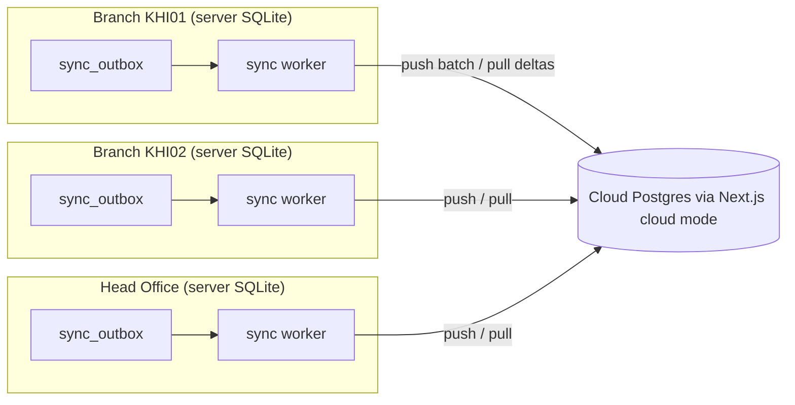
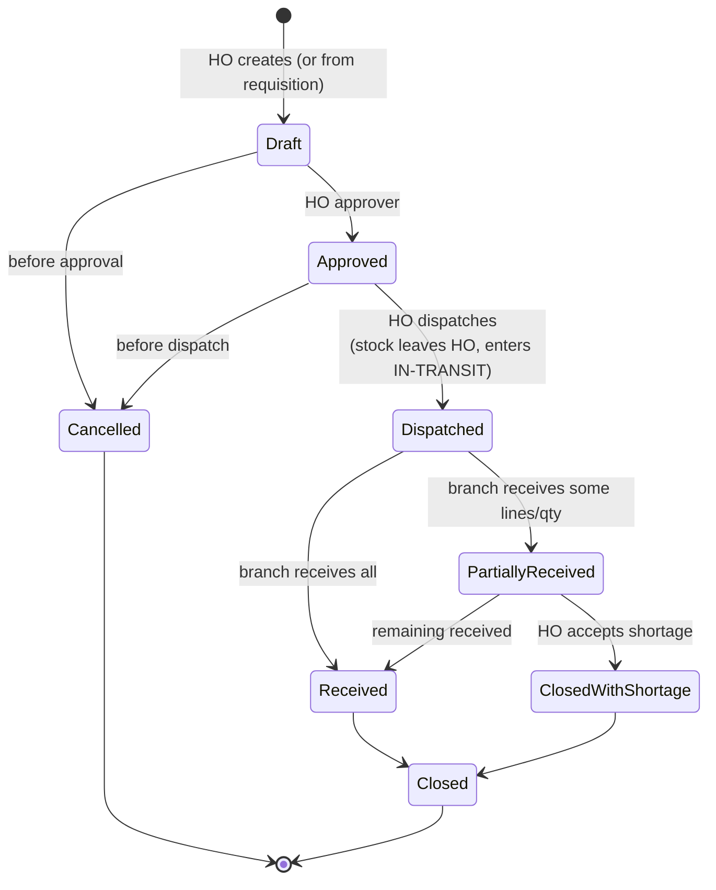

# Sync design

Status: **Draft for approval.** Implements CLAUDE.md §4.3. Nothing here is built yet.

## 1. Principles

1. Local first. No user-facing operation waits for the cloud. Sync is a background worker.
2. Sync **events**, not state snapshots, for anything financial or stock related.
3. Every push is idempotent. Every pull is resumable. Duplicates and reordering are harmless.
4. Two rules keep conflicts rare: stock and finance are append-only, and each document belongs to exactly one branch that alone creates it.

## 2. Topology

Hub and spoke. Branches never talk to each other directly, even for transfers: the transfer is a set of events routed through the cloud. **A branch that is offline for days simply queues events.**

Consequence to confirm with the owner (open-questions Q3): while HO and a branch cannot reach the cloud, an HO to branch transfer cannot be **received** by the branch. Dispatch at HO works (stock leaves HO into in-transit). Receiving waits for sync. If HO and the branch are on the same LAN with no internet, a direct LAN peer-sync could be added later. It is not planned.

## 3. Identifiers and clocks

- **IDs:** UUIDv7 (time-ordered, random tail). Generated on the device that creates the row. No coordination.
- **HLC (hybrid logical clock):** `hlc = wallMs(48 bit) . counter(16 bit) . deviceId8`, encoded as a sortable string. Rules:
  - On local event: `wall = max(now, last.wall)`, counter increments if wall unchanged.
  - On receiving remote hlc: `wall = max(now, last.wall, remote.wall)`, counter set accordingly.
  - **Clock-skew guard:** if a remote or local wall is more than **24 h** ahead of the server-verified time (cloud time when known), the event is accepted but flagged, and the device raises a "clock is wrong" warning. HLC never goes backwards, so a fast clock only affects ordering of concurrent master-data edits, never stock or money.
- **Business dates** (invoice date shown to the user) come from the branch server clock and are stored separately from `hlc`.

## 4. Outbox

- Every write path calls `recordChange(tx, entityType, entityId, op, payload)` inside the same transaction. A DB trigger-free approach is used (explicit in the repository layer), and a **parity test** fails if a synced table can be written without an outbox row.
- Outbox row: `{id (uuidv7), seq, entity_type, entity_id, op (insert|update|void), payload, hlc, device_id, branch_id, tenant_id, schema_version}`.
- **Payload rules:**
  - Documents (sales, GRNs, transfers, expenses): sent as a full aggregate (header, lines, payments, allocations, movements), so the cloud can apply it in one transaction.
  - Master data: sent as changed fields plus `version` and `base_version`.
  - Stock: the `stock_movements` rows belong to their document's aggregate. Standalone adjustment movements are their own events.
- **Push:**
  1. Worker selects unsent rows ordered by `seq`, in batches (default 200 events or 1 MB).
  2. `POST /sync/push` with `Idempotency-Key = first event id of the batch`, device token, epoch.
  3. Cloud applies each event in one transaction, records `event_id` in `sync_inbox_seen`, and returns per event `applied | duplicate | rejected(reason)`.
  4. Worker marks `ack_at`. `rejected` goes to `sync_conflicts` or an error queue, and never blocks later events.
- **Retry:** exponential backoff with jitter (2 s to 15 min cap), reset on success. Network errors never mark events failed. Only explicit `rejected` does.
- **Ordering:** cloud applies events for one aggregate in `hlc` order. Cross-aggregate order is not needed, except **dependencies**: a document event lists `depends_on` master ids. If a dependency is not there yet, the cloud holds the event in a **parking table** (default 7 days) and retries on arrival of the master row. This handles out-of-order delivery.

## 5. Pull, cursors and initial sync

- The cloud keeps a monotonically increasing `change_seq` (bigserial) per tenant on its applied-events table.
- A branch stores one cursor per `entity_type` in `sync_cursors`. `GET /sync/pull?entity=items&after=<cursor>&limit=500` returns events not authored by this device and in scope for this branch.
- **Scope of pull:**
  - Master data (items, prices, suppliers, taxes, roles, users of that branch): whole tenant.
  - Documents: only own branch's, plus documents addressed to this branch (transfers to it, requisitions from it). Other branches' sales are **not** pulled to a branch (cloud only). HO can be configured to pull everything for consolidated local reports, but the default is cloud reporting.
- **Initial sync:** a new branch installs, pairs, then pulls a **snapshot** (compressed NDJSON per entity, produced by the cloud) and then the cursor deltas after the snapshot's `change_seq`. Progress is shown in the wizard. It can resume.
- **Delta sync:** cursor-based, as above.
- **Resync / repair tools** (manager, Super Admin only, all audited):
  - *Re-pull entity X from scratch* (drops local copy of tenant-wide master data, keeps outbox).
  - *Verify*: compare row counts and rolling hash per entity with the cloud and list differences.
  - *Re-push range*: re-enqueue events by date (safe because cloud dedupes by event id).
  - *Rebuild stock balances* from movements.
  - *Export diagnostic bundle* (sync log, outbox stats, no PII).

## 6. Conflict rules

| Data class | Examples | Rule |
|---|---|---|
| Append-only ledger | stock_movements | No conflict possible. Union by id. Balance recomputed. |
| Posted documents | sales, returns, GRNs, expenses, payments, transfers, vouchers | Created in one branch only. Immutable. Duplicates dropped by id. Corrections are new documents. |
| Master data | items, suppliers, customers, categories, racks | Last-writer-wins by `hlc`, **only if** `base_version` matches cloud `version`. If not, the event is applied by LWW **and** a `sync_conflicts` row keeps the loser, plus audit entry of both values. Manager can review and re-apply. |
| Price-policy fields | retail price, MRP, discount caps, tax class | **Head Office wins.** A branch edit to these fields is accepted locally only if the branch has the `price.override.branch` permission, and is otherwise rejected by the server (not by sync). If accepted, HO value replaces it on next pull, and the conflict is logged. |
| Customers | walk-in and registered | LWW per field group (contact info versus credit limit). Credit limit changes are HO-only. Duplicate customers are merged by a document (`customer_merge`), not by deletion. |
| Users, roles, permissions | | Cloud/HO is the authority. Branch cannot edit them offline (except password/PIN of own users if enabled, which syncs as an event and wins by hlc). |
| Sequences | doc_counters | Per branch, never shared. No conflict. Block reservation for failover. |
| Settings | branch settings | Branch owns its settings. Tenant settings are HO owned. |

Deleting master data is always a soft delete (`deleted_at`). A soft delete of an item that has stock is refused.

## 7. Head Office to branch transfer states

Documents involved: **Requisition** (branch asks), **Transfer** (HO ships), **Transfer Receipt** (branch receives).

Ledger effect (all append-only `stock_movements`):

| Step | Movement rows |
|---|---|
| Dispatch | `transfer_out` at HO main store (negative) and `in_transit_out` into the branch's in-transit pseudo store (positive) |
| Receive (good qty) | `in_transit_in` (negative from in-transit) and `transfer_in` (positive at branch receiving store) |
| Damaged at receipt | in-transit reduced, branch `damaged` store increased, claim recorded against HO |
| Shortage | in-transit reduced, written off to `transfer_shortage` (loss account or recovered from carrier, decided at close) |
| Rejected / returned | Return-transfer document back to HO (new document, same flow reversed) |
| Cancel after dispatch | Not allowed. Use a return transfer. |

Rules:
- Batch and expiry are chosen at dispatch (FEFO suggestion, manual override with permission). The branch receives **the same batch numbers**, with the same expiry and cost basis (or transfer price if configured).
- Transfer price versus cost: `price_basis` on the transfer. Inter-branch accounting entries go to `inter_branch_balances` until the accounting module exists (Phase 4).
- A transfer to a branch that stays offline is **not lost**. The dispatch event syncs to cloud. The branch pulls it when online and can then receive.
- Every state change is an event with user, device, time. State only moves forward. Illegal transitions are rejected server-side.
- Receiving is idempotent by `(transfer_id, line_id, receipt_no)`.

## 8. Failure scenarios and expected behaviour

| # | Scenario | Expected behaviour | Test |
|---|---|---|---|
| 1 | Branch offline for 10 days, 3,000 sales | Sales continue. Outbox grows. On reconnect, pushes in batches, cloud totals match local totals. | Chaos: offline, sell, reconnect, compare aggregates |
| 2 | Same push sent twice (network timeout after cloud applied) | Second returns `duplicate` per event. No double sale, no double movement. | Replay test |
| 3 | Events delivered out of order (transfer receipt before dispatch) | Receipt parked until dispatch arrives, then applied. | Shuffle test |
| 4 | Sale references a new item created a minute earlier at HO, item not yet synced to cloud | Parked, applied when the item arrives. | Dependency test |
| 5 | Branch clock 3 days ahead | Events accepted, flagged, warning on the branch. Master-data ordering may prefer this branch's edits until the clock is fixed. Stock and finance unaffected. | Skew test |
| 6 | Two branches edit the same item's name offline | Later hlc wins. Loser saved in `sync_conflicts`. Both audited. | Conflict test |
| 7 | HO changes retail price while branch edits it offline | HO wins. Branch value logged in conflicts. | Policy test |
| 8 | Cloud rejects an event (validation changed, unknown enum) | Marked `rejected`, kept in error queue with reason, later events continue. Visible in Sync status UI, exportable. | Reject test |
| 9 | Branch server disk restored from older backup | Restored DB has outbox rows already acked by cloud, and is missing recent ones. Recovery: epoch bump, "reconcile with cloud" pulls the branch's own recent documents back from the cloud (cloud is the copy of record for acked events) and lists any local-only gap. | Restore test |
| 10 | Failover promotion (see architecture §6) | New epoch. Old primary fenced. Unreplicated tail exported for review. | Failover test |
| 11 | Partial network failure mid-batch | Cloud applies whole batch or per event atomically. Response lost, next attempt returns `duplicate`. | Fault injection |
| 12 | Terminal loses LAN mid-sale | Idempotency-Key makes the retry safe. UI shows "not saved" until server confirms. | E2E |
| 13 | Schema version mismatch (branch on an older app) | Cloud accepts down to N-1 schema. Older than that: sync pauses with an "update required" banner. POS keeps working. | Compat test |
| 14 | Cloud restore to an older point | Branches detect a cursor ahead of the cloud (`cursor_reset` marker) and offer full re-push of their events. | Reset test |
| 15 | Device stolen | Revoke device token in cloud. Its next push and pull fail. Local data still encrypted. | Revocation test |
| 16 | Very large first sync (100k items) | Snapshot NDJSON streamed in chunks, resumable, progress bar. Cold-start budget is not affected (runs in the background). | Perf test |

## 9. Sync status UI (Phase 1 skeleton, complete in Phase 3)

Online/offline indicator, last successful sync, pending outbox count, oldest unsent age, error list with reasons, **Sync now**, conflict review screen, "data as of" stamp on cloud dashboards.

## 10. Security

TLS to cloud. Device token plus tenant and branch scope on every call. Cloud re-checks RBAC and branch scope on the **event**, not only the connection (a compromised branch cannot post another branch's documents). Payload size limits. Rate limiting per device. PII in payloads is minimised (customer phone and CNIC are synced because the narcotic register needs them, and are encrypted at rest in Postgres).

## 11. Open points for approval

1. Direct HO to branch LAN peer-sync when the internet is down (default: not built).
2. Does HO pull all branch sales locally, or is HO reporting cloud-only (default: cloud-only)?
3. How long a branch may be offline before a warning (default: warn at 24 h, alert at 72 h, never block selling).
